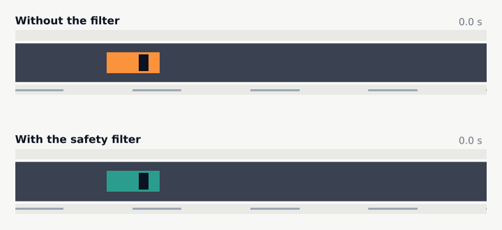
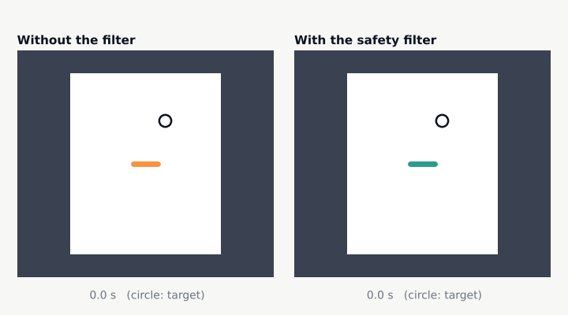
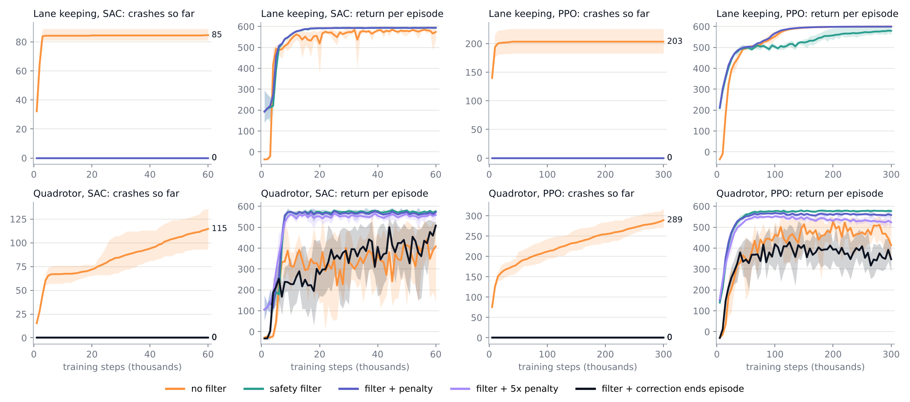
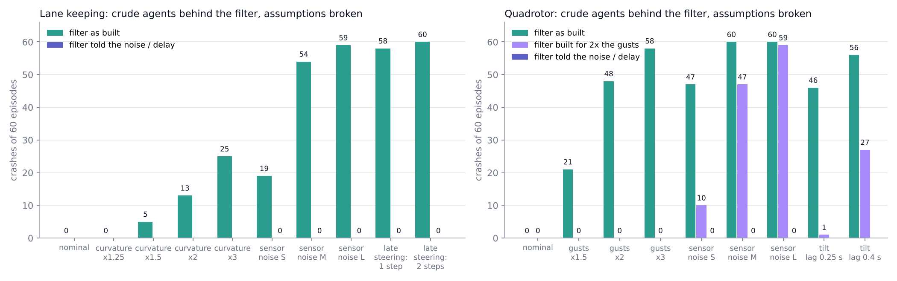
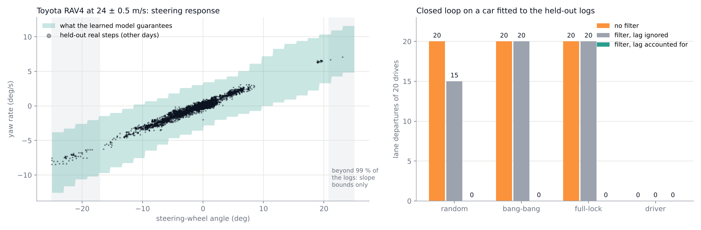
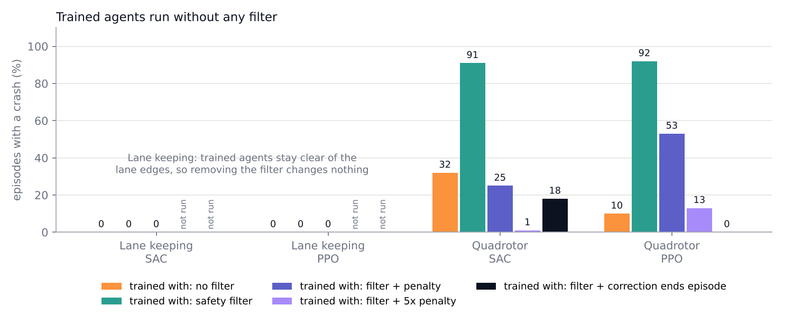

# safety-filter

**Certified safety filters for learning-based control, learned from data.**
A learning controller (reinforcement learning or DeePC) proposes an input; a filter built
with [ddma](https://github.com/anas-makdesi/ddma) from sampled transitions lets it through
when it is provably safe and replaces it with the closest safe input otherwise. The
guarantee holds during training and deployment, without a model of the system.

| Lane keeping | Quadrotor in a corridor |
|---|---|
|  |  |

*The same agent early in its training (PPO after 6,000 steps, still exploring), with the
same random numbers, run alone (orange) and behind the filter (teal). Alone it leaves the
lane after 2.5 s and the corridor after 3.1 s.*

## Results

Two benchmarks (a car keeping its lane, a quadrotor in a corridor), four controllers
(SAC, PPO, DeePC, and an MPC that knows the true model), each with and without the filter.
Everything below comes from `results/evaluation.json`; the tables are printed by
`experiments/07_tables.py`.

**1. No crash while learning.** Reinforcement-learning agents learn by trial and error.
Without the filter each training run crashed 81 to 318 times; behind the filter, none of
the 40 runs crashed once.

| Benchmark | Agent | Training steps | Crashes, no filter (mean, range over 5 seeds) | Crashes, safety filter |
|---|---|---:|---:|---:|
| Lane keeping | SAC | 60,000 | 85 (81–89) | 0 |
| Lane keeping | PPO | 300,000 | 203 (183–226) | 0 |
| Quadrotor | SAC | 60,000 | 115 (93–136) | 0 |
| Quadrotor | PPO | 300,000 | 290 (271–318) | 0 |



**2. No crash after training, at almost no cost.** 20 held-out episodes of 30 s (roads and
target paths never seen in training); the return is at most 600. For the RL agents,
"alone" is an agent trained and run without the filter, "with filter" one trained and run
behind it.

| Benchmark | Controller | Alone: crashes | Alone: return | With filter: crashes | With filter: return | Steps the filter changed |
|---|---|---:|---:|---:|---:|---:|
| Lane keeping | SAC (5 seeds) | 0 / 100 | 585 | 0 / 100 | 599 | 0 % |
| Lane keeping | PPO (5 seeds) | 0 / 100 | 600 | 0 / 100 | 582 | 0 % |
| Lane keeping | DeePC | 0 / 20 | 600.0 | 0 / 20 | 600.0 | 0 % |
| Lane keeping | MPC, true model | 0 / 20 | 600.0 | 0 / 20 | 600.0 | 0 % |
| Quadrotor | SAC (5 seeds) | 32 / 100 | 388 | 0 / 100 | 574 | 23 % |
| Quadrotor | PPO (5 seeds) | 10 / 100 | 517 | 0 / 100 | 578 | 29 % |
| Quadrotor | DeePC | 0 / 20 | 579.0 | 0 / 20 | 578.5 | 3.9 % |
| Quadrotor | MPC, true model | 0 / 20 | 581.8 | 0 / 20 | 581.2 | 9.3 % |

- On the quadrotor the target flies beyond the walls. Agents trained without the filter
  still hit a wall in 10 to 32 % of the test episodes; behind the filter they follow the
  target up to the wall and reach 98–99 % of the true-model MPC's return.
- For the controllers that already respect the walls (DeePC, MPC) the filter costs
  0.1 % of the return.
- Lane keeping is easy once learned: no trained controller leaves the lane, and the
  filter never steps in. Its value there is during learning.

**DeePC with less favourable data or tuning** (`experiments/13_deepc_variants.py`,
variants fixed before running, 20 held-out episodes each). On the quadrotor:

| DeePC variant | Alone: crashes | Alone: return | With filter: crashes | With filter: return |
|---|---:|---:|---:|---:|
| As tuned above (20 s of data, 10 cm wall margin) | 0 / 20 | 579.0 | 0 / 20 | 578.5 |
| 6 s of data | 5 / 20 | 421.9 | 0 / 20 | 546.7 |
| No wall margin | 2 / 20 | 554.6 | 0 / 20 | 581.0 |
| Noisy recorded data | 0 / 20 | 557.5 | 0 / 20 | 557.5 |
| Stiffer wall constraints | 0 / 20 | 579.0 | 0 / 20 | 578.5 |

On lane keeping none of the four variants (default, 4 s of data, noisy data, stiffer
limits) left the lane, and the filter never stepped in.

**3. Time.** The filter is a table lookup: about 0.1 ms per call for lane keeping and
0.2 ms for the quadrotor (Python, one thread; 99th percentile below 1 ms). For comparison:
an RL policy takes 0.1–0.2 ms, the MPC about 5 ms, DeePC 4 ms (lane keeping) to 50 ms
(quadrotor). In training, the filter takes 2–3 % of the time with SAC and 20–30 % with
PPO (PPO's own cost per step is small).

**4. When the assumptions are wrong.** The guarantee rests on stated assumptions, so each
one was broken on purpose (`experiments/08_stress_test.py`, 20 held-out episodes per
case). Crude agents (random, bang-bang or target-chasing, full lock or full thrust) push
the system to the edge of the certified set, where a broken assumption shows first.



| What is broken | Filter as built: crashes of 60 | Fix | Crashes with the fix |
|---|---:|---|---:|
| Road curvature 1.25x / 1.5x / 2x / 3x its bound | 0 / 5 / 13 / 25 | – | – |
| Gusts 1.5x / 2x / 3x their bound (quadrotor) | 21 / 48 / 58 | build the filter for 2x the gusts | 0 / 0 / 0 |
| Sensor noise S / M / L on the state the filter sees | lane 19 / 54 / 59, quadrotor 47 / 60 / 60 | tell the filter the noise bound | 0 everywhere |
| Steering applied 1 / 2 steps (50 / 100 ms) late | 58 / 60 | let the filter predict through the delay | 0 / 0 |
| Slower tilt than assumed (0.25 s / 0.4 s instead of 0.15 s) | 46 / 56 | filter built for 2x the gusts | 1 / 27 |

- **A broken assumption shows first at the edge of the certified set.** The filter keeps
  the system up to the boundary of what is provably safe, so a small violation there is enough: 1 cm of sensor noise
  or one step of delay lets most crude agents crash. Controllers that stay away from the
  edge are unaffected: the MPC with the filter never crashed in any noise or curvature
  case.
- **Two fixes, both now in the package** (heuristics; `filters/robust.py` is a prototype
  of the same two with a proof: a measurement-robust safe set, and a known delay reduced
  to a measurement error by set prediction). `AbstractionFilter.state_error`: the filter
  allows only inputs that are safe for every state the measurement could hide.
  `DelayAwareFilter`: it predicts, with its own learned model, where the system can be
  when the input takes effect, and filters for all of those states. A margin on the
  disturbance (the "2x gusts" filter) costs certified area: 18 % / 62 % instead of
  43 % / 80 %.
- **The broken assumption can be seen coming.** ddma's assumption monitor, watching the
  transitions the filter sees, raised an alarm before every one of the 713 crashes, a
  median of 1.0 s (lane) and 1.6 s (quadrotor) before, at least 0.2 s. With intact
  assumptions it raised none.

**5. A filter from a real car's logs.** The lane-keeping filter was also learned from
real driving: a Toyota RAV4 on a California highway from the comma2k19 dataset
(`experiments/11_real_lane.py`; MIT licence, see `data/README.md`). The steering response
(speed and steering-wheel angle → yaw rate) is the only car-specific part of the model,
and it comes from 42 minutes of logs at 72–100 km/h; the lane geometry is exact
kinematics. 55 minutes from other days are held out.



- **The assumptions hold on the data.** With the yaw rate's single-sample spikes removed
  (0.25 s running median), all learning and held-out steps are consistent with the stated
  slope bounds and a yaw-rate error of 0.03 rad/s (checked pairwise by `ddma.check_data`).
- **The learned model holds on held-out data:** all 65,581 held-out real steps fall
  inside the box it predicts.
- **Closed loop on a car fitted to the held-out logs** (steady-state cornering, the real
  residuals replayed in order, the measured 50 ms steering lag), 20 drives per agent:
  crude agents leave the lane in 20 of 20 drives without the filter, 15–20 behind a filter
  that ignores the lag, and **0 behind the delay-aware filter**. A plain lane-centring
  driver never needs it (0.1 % of steps changed).
- **Scope.** The certified share is 39 % of the specification. The yaw rate the steady
  picture cannot explain (road bank, wind, the car's own dynamics; up to 0.03 rad/s) is
  as large as what ±12° of steering produces at highway speed, so the filter needs
  steering up to ±25°; beyond the range of the logs (99 % within −17°…+21°) the response
  comes from the stated slope bounds. Road curves are limited to a
  2 km radius. The closed loop runs on a car model fitted to the held-out real logs.

### Further findings

- **Agents trained behind the filter rely on it, unless training discourages it.** On
  the quadrotor, remove the filter after training and plain filter-trained agents crash
  in 91–92 of 100 episodes: they have learned to fly at the target and let the filter stop
  them. Two stronger training signals were tested against this (5 seeds each, still 0
  crashes while learning):

  | Agent | Trained with | Return behind the filter | Filter removed: crashes of 100 | Filter removed: return |
  |---|---|---:|---:|---:|
  | SAC | filter | 574 | 91 | 148 |
  | SAC | filter + penalty | 566 | 25 | 494 |
  | SAC | filter + 5x penalty | 553 | 1 | 548 |
  | SAC | filter, a correction ends the episode | 485 | 18 | 437 |
  | PPO | filter | 578 | 92 | 93 |
  | PPO | filter + penalty | 560 | 53 | 332 |
  | PPO | filter + 5x penalty | 523 | 13 | 492 |
  | PPO | filter, a correction ends the episode | 464 | 0 | 464 |

  Reliance can be removed almost entirely, at a cost of 4 % (SAC, 5x penalty) to 20 %
  (PPO, episode ends) of the return. The SAC agent trained with the 5x penalty, run with
  no filter at all, beats the SAC agent trained without one (548 and 1 crash against
  388 and 32 crashes) and never crashed while learning. Treating a correction as a crash
  (`end_on_correction=`) works for PPO but makes learning noisier for SAC. Without such
  a signal, the filter is a permanent part of the control loop, not training wheels.

  

  *On lane keeping, every trained agent stays clear of the lane edges, so removing the
  filter changes nothing; the 5x-penalty and correction-ends-episode arms were run on the
  quadrotor only.*

- **The filter can change what is learned.** On lane keeping, PPO trained behind the
  filter ended 3 % below PPO trained without it (582 ± 14 against 600), although the
  filter never corrects the trained agent; with the penalty the gap disappears (600).
  SAC went the other way (599 behind the filter, 585 without).
- **DeePC and MPC did not need the filter here.** Both know the limits and stayed inside
  them on all test episodes. Their safety rests on tuning (constraint back-off,
  regularisation) and on the disturbance staying small, rather than on a certificate.
- **What is guaranteed:** if the state starts in the certified set, is measured exactly
  (or within a bound the filter is told) and the assumptions hold (derivative and
  disturbance bounds, inputs acting when expected or with a delay the filter is told),
  the state never leaves the specification. The certified set is 46 % of the lane specification and 43 % / 80 %
  (lateral / vertical) of the corridor's; the guarantee covers states inside it.
- **Training budgets** (60,000 steps for SAC, 300,000 for PPO, library-default
  hyperparameters, 5 seeds): sized for the comparison rather than for the best return.

### Reproduce

```bash
pip install -e ".[dev,rl,deepc,plots]"
python experiments/03_train_rl.py     # 60 training runs; several hours on two cores
python experiments/03_train_rl.py --conditions penalty5 stop --bench quad   # 20 more
python experiments/04_evaluate.py     # DeePC, MPC, all trained agents, timing
python experiments/05_figures.py && python experiments/06_video.py
python experiments/07_tables.py       # the tables above
python experiments/08_stress_test.py  # assumptions broken on purpose (about 1.5 h)
python experiments/11_real_lane.py    # real RAV4 data (uses data/comma2k19_rav4_steps.npz)
python experiments/12_followup_figures.py
python experiments/13_deepc_variants.py   # DeePC tuning and data variants (about 2 h)
```

## The controllers

| Controller | What it is | Code |
|---|---|---|
| SAC, PPO | Reinforcement learning (Stable-Baselines3, PyTorch). The filter sits between the agent and the simulator, so the same training code runs with and without it. | `controllers/rl.py` |
| DeePC | Data-enabled predictive control (CVXPY + OSQP): predicts with recorded trajectories instead of a model; regularised, reduced by SVD. | `controllers/deepc.py` |
| MPC, true model | The reference: knows the equations and what lies ahead. Not learned. | `controllers/mpc.py` |

## Lane keeping

A car on a random road with bounded curvature, modelled as a kinematic bicycle in road
coordinates: lateral offset `e_y`, heading error `e_psi`, speed `v` (15–30 m/s), steering
angle `delta` (|delta| ≤ 0.05 rad). Road curvature (|kappa| ≤ 0.004 1/m) is unknown to the
filter. Specification: the car stays in its lane, |e_y| ≤ 0.85 m, and |e_psi| ≤ 0.2 rad.

The filter knows only: the state is integrated (x⁺ = x + f(x, delta) + w), which
coordinates each increment depends on, bounds on the partial derivatives of f and on the
disturbance, and the data.

### Abstraction filter (F1)

2·10⁶ random transitions → bounded-derivative model (ddma, growth cones) → symbolic
abstraction on 160 × 120 × 24 cells × 21 steering cells → maximal safe set.

| | |
|---|---|
| Certified share of the lane specification | 46 % (same grid from the exact model: 54 %; fine grid at a fixed speed: 59–62 %, close to the true maximum) |
| Learning + abstraction + synthesis | about 4 s |
| Filter memory | 9 MB |
| Filter call | about 80 µs in Python |
| Random, bang-bang and full-lock steering agents | 0 lane departures with the filter (all of them leave the lane without it) |

Reproduce (both benchmarks): `python experiments/02_build_filters.py`.

## Quadrotor

A quadrotor flying in a corridor (lateral–vertical plane), with the cascaded structure of
PX4-style autopilots: the learned agent outputs acceleration setpoints and the attitude
and thrust loops underneath realise them (lateral acceleration with a 0.15 s lag).
Quadratic drag, wind gusts up to 0.5 m/s². Specification: |y| ≤ 1 m (walls),
0.3 m ≤ z ≤ 2.7 m (floor and ceiling), |vy| ≤ 3 m/s, |vz| ≤ 2 m/s. The task: follow a
target that sometimes passes beyond the walls.

The two channels are decoupled, so each has its own abstraction filter, learned from
the same 2·10⁶ transitions: lateral (y, vy, a_y) on 120 × 240 × 40 cells, vertical
(z, vz) on 120 × 80 cells, 21 input cells each.

| | |
|---|---|
| Certified share of the specification | lateral 43 %, vertical 80 % |
| Learning + abstraction + synthesis | about 9 s |
| Filter memory | 23 MB |
| Random, target-chasing and full-thrust agents | 0 wall or floor hits with the filter (all of them crash without it) |

Integrator chains need fine grids in velocity: with fewer than ~120 velocity cells the
lateral abstraction certifies nothing.

## Why no gridless envelopes here

ddma's gridless envelopes (v0.9) certify sets kept invariant by a *constant* range of
inputs. Both benchmarks are integrator chains (steering → heading → offset; acceleration
→ speed → position), where that is not possible without a fixed baseline loop; even with
one, they certify at most ~12 % of the lane in one speed band and leave the learned
controller almost no authority (`experiments/00_envelope_feasibility.py`). They remain
the right tool for systems that settle on their own (e.g. ddma's room-cooling example).

## Layout

```
src/sfilter/envs/       lane keeping (Gymnasium) + road generator, quadrotor in a corridor
src/sfilter/filters/    SafetyFilter interface + Gym wrapper, abstraction filters (F1),
                        noise-aware (state_error) and delay-aware filtering
src/sfilter/real/       real RAV4 data (comma2k19): steering response, real-car filter
src/sfilter/controllers RL training (SAC, PPO), DeePC, reference MPC
src/sfilter/evaluation  held-out evaluation of any controller, with or without a filter
experiments/            numbered scripts producing results/ and figures/
tests/                  environment, assumptions, filter safety
```

## Install

```bash
pip install -e ".[dev]"                  # pulls ddma from GitHub
pip install -e ".[dev,rl,deepc,plots]"   # with the learned controllers and figures
pip install -e ".[real]"                 # real-data experiments (scipy, remotezip)
pytest -q
```

## Credits

Anas Makdesi. Built on ddma (Makdesi, Girard, Fribourg, Zamani, Jafarpour).
Code written with the help of Claude (Anthropic).
